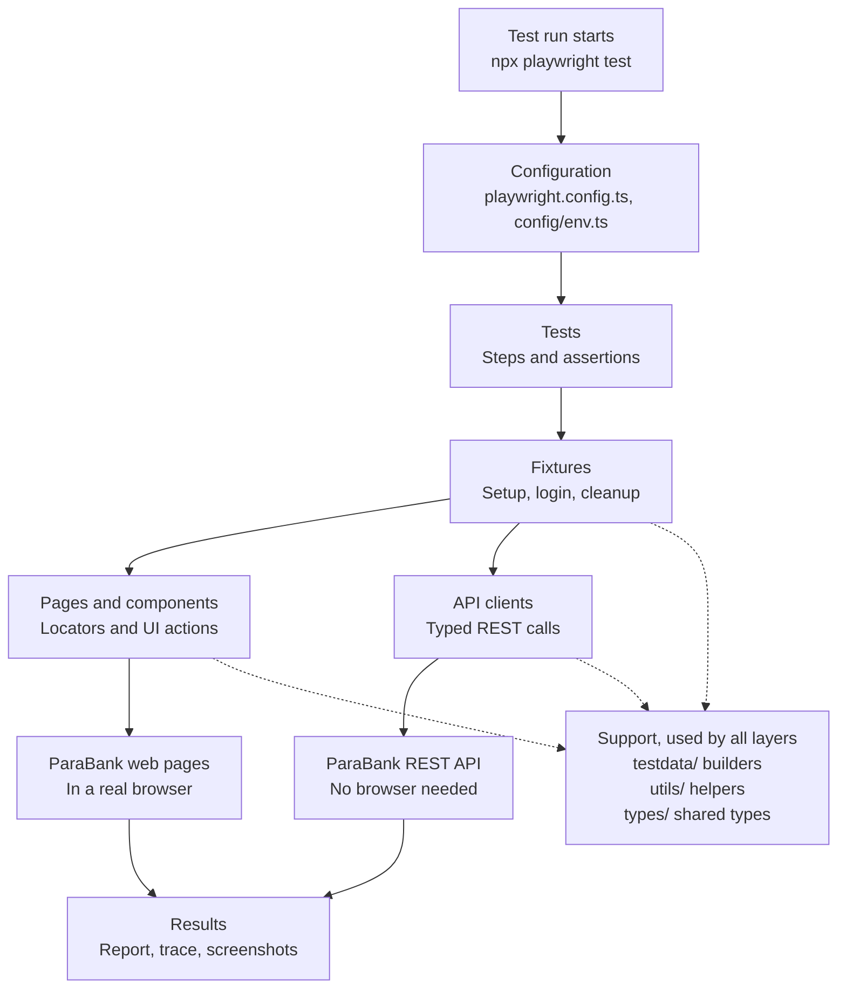
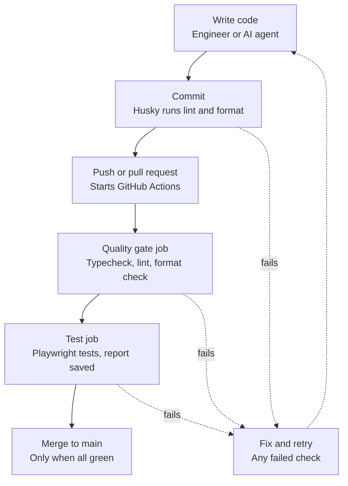

# Architecture and flow diagrams

Two diagrams explain the framework: how a test run flows through the
layers, and how code travels from the editor to `main`.

The diagrams are written in Mermaid. GitHub shows them as pictures. In
VS Code, install the extension "Markdown Preview Mermaid Support" if the
preview shows only text.

## 1. Test run: flow through the layers

How to read it:

- Arrows point downward only. Each layer calls the one below it, never the
  one above. This is the layer rule.
- Configuration comes first. It decides the browser, retries, and which
  server to test, before any test starts.
- The path splits after fixtures. A UI test goes through pages and
  components to the browser. An API test goes through API clients straight
  to the REST API. An end-to-end test uses both.
- Support (dashed lines) is used by every layer, so it is not part of the
  top-to-bottom chain.

| Box in the diagram   | Folder or file                        |
| -------------------- | ------------------------------------- |
| Configuration        | `playwright.config.ts`, `config/`     |
| Tests                | `tests/`                              |
| Fixtures             | `fixtures/`                           |
| Pages and components | `pages/`, `components/`               |
| API clients          | `api/endpoints/`, `api/schemas/`      |
| Support              | `testdata/`, `utils/`, `types/`       |
| Results              | `playwright-report/`, `test-results/` |

## 2. Delivery: from writing code to merge

How to read it:

- Three automatic checks stand between the code and `main`: the commit
  hook, the quality gate job, and the test job.
- Each check is stricter and slower than the one before, so cheap problems
  are caught early.
- Any failure (dashed lines) sends the work back to fix and retry. Nothing
  reaches `main` with a red check.

| Box in the diagram | Where it is defined                                  |
| ------------------ | ---------------------------------------------------- |
| Commit             | `.husky/pre-commit`, `lint-staged` in `package.json` |
| Quality gate job   | `.github/workflows/playwright.yml`, job `quality`    |
| Test job           | `.github/workflows/playwright.yml`, job `test`       |
| Merge to main      | Branch protection on GitHub (Phase 8)                |

## Status

| Part                                    | Status                                       |
| --------------------------------------- | -------------------------------------------- |
| Commit hook, quality gate job, test job | Built in Phase 1                             |
| Configuration                           | Starter version; completed in Phase 2        |
| Tests, fixtures, pages, API clients     | Folders ready; code arrives in Phases 2 to 5 |
| Merge only when green                   | Planned in Phase 8                           |
